# ARCHITECTURE.md — Arsitektur Sistem Prehistoric Tribes Web

Dokumen arsitektur resmi untuk repositori `prehistoric_tribes_web`. Dokumen ini mencatat seluruh peta sistem, alur data, struktur folder, tata kelola memori, dan penyekat platform (*platform seams*) agar pengembang dan agen AI dapat memahami sistem secara presisi dan mendalam.

---

## 1. Architecture Overview

**Prehistoric Tribes Web** adalah port modern dari game RTS/simulasi suku purba legendaris era J2ME (Java Mobile) yang dibangun ulang menggunakan **TypeScript, Vite, dan HTML5 Canvas 2D**. Permainan ini dibungkus secara mandiri (*standalone offline packaging*) untuk platform **Windows Desktop (`.exe`)** dan **Android Mobile (`.apk`)** menggunakan framework **Tauri 2**.

### Prinsip Utama Desain (*Design Tenets*):
1. **Single Source of Truth:** Seluruh logika simulasi, aturan game, dan aset berada di dalam web frontend (`web/src/`). Shell native Tauri 2 hanya berfungsi sebagai wrapper runtime tanpa logika game ganda.
2. **Platform Seams Invariant:** Modul game dan simulasi dilarang keras mengimpor API Tauri atau dependensi native secara langsung. Seluruh akses native dibatasi ketat di balik adapter pada `web/src/platform/`.
3. **Flat TypedArray Memory (Data-Oriented):** Menyerap arsitektur memori bawaan bytecode original (`DenseLayout.ts`) yang menggunakan array biner datar (`Int8Array` / `Int16Array`) untuk performa komputasi instan tanpa overhead Garbage Collection.
4. **Decoupled Simulation & Presentation:** Simulasi permainan berjalan pada kecepatan pasti **10 Ticks / Detik (Fixed Simulation Loop, 120 ms)**, sedangkan rendering kanvas dan komposisi display berjalan halus pada **60 / 120 FPS** via `requestAnimationFrame`.
5. **Zero-Allocation Inner Loop:** Perulangan rendering tile peta dan kalkulasi status entitas beroperasi langsung di atas TypedArray tanpa alokasi objek dinamis per frame.
---

## 2. High-Level System Diagram

```mermaid
flowchart TD
    subgraph NativeShell ["Native Shell Layer (Tauri 2)"]
        WinExe["Windows Desktop (.exe)<br>Microsoft WebView2"]
        AndApk["Android Mobile (.apk)<br>Android System WebView"]
    end

    subgraph PlatformAdapters ["Platform Abstraction Layer (web/src/platform/)"]
        StorageAdapter["Storage.ts<br>(LocalStorage / SQLite)"]
        BackBtnAdapter["BackButton.ts<br>(Android Hardware Back)"]
        HapticAdapter["Haptic.ts<br>(Device Vibration)"]
        LifecycleAdapter["PageLifecycle.ts<br>(Auto-pause Background)"]
    end

    subgraph CoreEngine ["Core Engine & State (web/src/core/)"]
        DenseState["DenseLayout.ts<br>(Flat Int8Array: HP, Age, Orders, XY)"]
        BinaryDB["Binary Resources<br>(pd0: Rules, ma: Maps, sa: Audio)"]
        RuntimeState["LegacyRuntimeState.ts<br>(Global State Machine & Loop Control)"]
    end

    subgraph SimulationDomain ["Simulation Domain (Fixed 10 Ticks/s)"]
        TribeSim["sim/tribe/<br>Ekonomi Suku, Kelaparan, SmartHarvesting"]
        UnitSim["sim/units/<br>AI Warga, Pathfinding, Combat Leveling"]
        WorldSim["sim/world/<br>Footprint Gedung, Peta, Regenerasi Alam"]
        TacticsSim["combat/<br>TribeTactics (Attack-Move, Rally), AnimalEcology"]
    end

    subgraph PresentationDomain ["Presentation Domain (60 FPS)"]
        HdEngine["render/HdArt.ts & WideView.ts<br>Upscale 2x/4x HD Canvas Renderer"]
        AtmosphereSystem["render/<br>DayNightCycle, WeatherSystem, WorldParticles"]
        HudLayer["hud/ & ui/<br>TopBar, BuildCards, VillagerPanel, TouchControls"]
    end

    NativeShell --> PlatformAdapters
    PlatformAdapters --> CoreEngine
    CoreEngine --> SimulationDomain
    SimulationDomain --> PresentationDomain
```



---

## 3. Project Structure

```text
prehistoric_tribes_web/
├── docs/                               # Dokumentasi teknis & panduan proyek
│   ├── plan/                           # Roadmap PWA/TWA/Tauri & modularisasi
│   ├── asset-enchant-guide.md          # Panduan remastering aset Real-ESRGAN
│   └── translation-zh-CN.json          # Basis terjemahan bahasa
├── web/                                # Frontend Web Application (Vite + TypeScript)
│   ├── public/                         # Aset statis yang disajikan ke browser / webview
│   │   ├── assets/                     # Database biner bytecode original (pd0, ma, sa, lang)
│   │   ├── hd/                         # Aset visual remastering resolusi tinggi (2x & 4x Ultra HD)
│   │   │   ├── animals/                # Sprite binatang purba (Mammoth, Smilodon, dll.)
│   │   │   ├── buildings/              # Sprite gedung (Hut, Kitchen, Gym, Range, Storehouse)
│   │   │   ├── effects/                # Sprite efek animasi partikel
│   │   │   ├── objects/                # Pepohonan, bebatuan alam, semak buah
│   │   │   ├── parts/ & parts-v0..v5/  # Potongan modular sendi tubuh karakter
│   │   │   ├── story/faces/            # Potret wajah karakter cerita
│   │   │   ├── terrain/                # Tile permukaan tanah & tebing (11, 13, 16, 17, 19, 4, 6, 8)
│   │   │   └── ui/                     # Ikon menu, tombol aksi, dan badge status
│   │   └── manifest.webmanifest        # Manifest PWA standar
│   ├── scripts/                        # Script build, testing, dan size ratchet gate
│   │   ├── browser-smoke.mjs           # E2E test otomatis Playwright di browser headless
│   │   ├── check-file-size.mjs         # Gate pengawas batas ukuran baris file
│   │   ├── size-baseline.json          # Baseline ratchet ukuran file
│   │   └── test-all.mjs                # Test runner untuk seluruh unit tests
│   ├── src-tauri/                      # Konfigurasi native Rust Tauri 2 (Windows & Android)
│   │   ├── Cargo.toml                  # Dependensi Rust & metadata aplikasi
│   │   ├── tauri.conf.json             # Konfigurasi window, permissions, dan bundle id
│   │   └── src/lib.rs                  # Entry point native Rust
│   └── src/                            # Source code TypeScript game
│       ├── audio/                      # Sistem tata suara & musik atmosfer
│       ├── combat/                     # Taktik tempur RTS modern & ekologi fauna
│       ├── core/                       # Layout memori data datar & runtime bootstrap
│       ├── hud/                        # Antarmuka HUD permainan (TopBar, Build Cards, Stepper)
│       ├── platform/                   # Adapter abstraksi native (Storage, Haptic, BackButton)
│       ├── render/                     # Pipeline render kanvas, HD Art, partikel, & cuaca
│       ├── save/                       # Serialisasi & persistensi save game format RMS
│       ├── sim/                        # Domain simulasi (tribe, units, world)
│       ├── styles/                     # CSS modular antarmuka game
│       ├── text/                       # Pengolah teks & dekompresi string original
│       ├── ui/                         # Kontrol sentuh, modal popup, dan alur menu
│       ├── main.ts                     # Entry point web application
│       └── mainRuntime.ts              # Game loop utama (tick, update, render orchestration)
├── AGENTS.md                           # Aturan universal rekayasa software untuk AI
└── ARCHITECTURE.md                     # Dokumen arsitektur sistem (file ini)
```

---

## 4. Rincian Modul & Komponen Kunci

### A. Core Engine (`web/src/core/`)
Arsitektur game mempertahankan format memori data flat bawaan emulator bytecode Java:
* **`DenseLayout.ts`:** **(Paling Krusial)** Berisi konstanta alamat offset array memori integer datar (`Int8Array(9983)`). Seluruh identitas entitas disimpan dalam indeks angka flat:
  * **Partisi Unit (ID 1..100, stride 101 byte):** ID 1..50 untuk Tim 0 (Pemain), ID 51..100 untuk Tim 1 (AI Musuh).
    * `UNIT_HP = 1919`, `UNIT_MAX_HP = 6767`, `UNIT_AGE = 1414`, `UNIT_GENDER = 1515`.
    * `UNIT_ORDER = 6161` (`0`: Idle, `1`: Tempur, `2`: Berjalan ke Koordinat Sasaran, `3`: Memanen/Bekerja).
    * `UNIT_MODE = 2929` (Status gerak/animasi: `1` berjalan, `20` siap tempur).
    * `UNIT_TARGET_X = 3131`, `UNIT_TARGET_Y = 3232` (Koordinat tujuan langkah).
    * `UNIT_WORK_TARGET = 4747` (Target aksi: `-1..-30` gedung pemain, `-31..-60` gedung musuh, `-61..-110` sumber daya alam, `<=-123` binatang buruan).
  * **Partisi Gedung (ID 1..60, stride 61 byte):** ID 1..30 (Pemain), ID 31..60 (Musuh). `BLD_HP = 8505`, `BLD_KIND = 8749`, `BLD_OWNER = 8810`, `BLD_WORKERS = 8932`.
  * **Partisi Fauna (22 slot, stride 22 byte):** `ANIMAL_X = 9359`, `ANIMAL_Y = 9381`, `ANIMAL_HP = 9513`, `ANIMAL_KIND = 9535`.
  * **Partisi Sumber Daya Alam (50 slot, stride 50 byte):** `RES_X = 9733`, `RES_Y = 9783`, `RES_KIND = 9833`, `RES_AMOUNT = 9883`.
  * **Array Pendukung:** `mainArrays.aShort` (`Int16Array[2][26]`) untuk stok pool gudang & senjata; `subsystemArrays.a` (`Int8Array[2][101][80]`) untuk tabel koordinat waypoint rute pathfinding.
* **`DataTables.ts`:** Pemetaan index tabel data biner `/pd0` (tabel max HP berdasarkan umur, kalkulasi damage, biaya gedung).
* **`LegacyRuntimeState.ts`:** Objek penampung (*state holder*) utama permainan yang menyatukan memori array, status layar saat ini (`loopMode`), dan frame counter. Memiliki guard kondisional `typeof document === "undefined"` agar test runner Node.js dapat berjalan murni tanpa DOM.
### B. Domain Simulasi (`web/src/sim/`)
Berjalan pada loop tetap **10 kali per detik** (`FixedLoop.ts`):
* **`sim/tribe/` (Sosial & Ekonomi Suku):**
  * `SmartHarvesting.ts`: Mengatur agar warga yang baru menyelesaikan satu pohon/batu otomatis mencari sumber daya sejenis terdekat tanpa perlu diperintah ulang manual oleh pemain.
  * `TribeRuntime.ts`: Hub orkestrasi per-frame untuk kebutuhan warga (kelaparan, stamina, kebahagiaan).
  * `LegacyEntityHousing.ts`: Logika pemilihan gubuk tempat tinggal bagi warga suku.
* **`sim/units/` (Karakter & Aksi Entitas):**
  * `UnitRuntime.ts`: Manajemen siklus hidup warga (kelahiran, penuaan, kematian).
  * `LegacyEntityCoreUpdate.ts`: Pembaruan status fisik entitas per tick.
  * `LegacyEntityEquipIssue.ts`: Algoritma pemilihan senjata di gudang berdasarkan bakat tarung alami warga (jarak dekat vs panah).
* **`sim/world/` (Dunia & Lingkungan):**
  * `WorldRuntime.ts`: Logika pemuatan peta misi, verifikasi tapak tanah bangunan, dan pertumbuhan vegetasi.
  * `LegacyMapRleDecoder.ts`: Dekoder kompresi RLE untuk membaca file peta biner `assets/ma`.

### C. Pipeline Render & Grafis (`web/src/render/`)
* **`Dual-Loop Compositor`:** Pemisahan ketat antara *gameplay logic paint* (120 ms diskrit) dan *display compositor* (60 / 120 Hz via `requestAnimationFrame` di `WideScreen.ts:screen.compose()`). Panning kamera digerakkan langsung oleh GPU tanpa membebani tick logika.
* **`HdArt.ts`:** **(Paling Krusial)** Mesin yang menerjemahkan sprite resolusi rendah 1x menjadi visual **HD Art (Hybrid 2x / 4x Ultra HD)** secara proporsional menggunakan kalkulasi matriks `drawScaled(hd, x, y, width, height)`.
* **`WideView.ts`:** Menggambar viewport dunia yang lebih lebar dari resolusi ponsel jadul 240x320 agar memenuhi rasio layar modern secara responsif.
  * *Invarian Render Snapshot:* State snapshot saat me-render wide view dibatasi ketat hanya pada koordinat viewport/kursor transient (`cursorColumn`, `cursorRow`, `cameraColumn`, `cameraRow`, `viewColumns`, `viewRows`, `targetSlot`), dilarang menduplikasi TypedArray runtime secara penuh agar terhindar dari lonjakan Garbage Collection.
* **`MapMargin.ts`:** Merender pemandangan tepi border luar peta (pepohonan, tebing, dan semak) secara adaptif terhadap rasio pembesaran aset 4x sehingga menyatu alami dengan peta.
* **`DayNightCycle.ts`:** Mengatur pencahayaan atmosfer siklus siang, senja keemasan, dan malam hari dengan radius cahaya api unggun.
* **`WeatherSystem.ts`:** Mengatur cuaca dinamis (hujan lebat yang meningkatkan kesuburan semak buah dan salju musim dingin yang menguras stamina).
* **`WorldParticles.ts`:** Sistem partikel ringan untuk asap perapian gubuk, debu pembangunan, jejak kaki di salju/lumpur, dan kawanan burung purba di angkasa.
### D. Antarmuka Pengguna & Kontrol Sentuh (`web/src/hud/` & `web/src/ui/`)
* **`TopBar.ts`:** Bilah status atas untuk memantau Populasi, Makanan, Kayu, dan Batu secara interaktif. Mengetuk ikon populasi membuka daftar warga desa.
* **`BuildList.ts` & `BuildingCatalog.ts`:** Menu kartu pembangunan fasilitas suku (Hut, Kitchen, Gym, Range, Armory, Storehouse, dll.) lengkap dengan indikator pintu depan (*front door indicator*).
* **`VillagerPanel.ts`:** Panel informasi detail warga suku (kondisi kesehatan, umur, spesialisasi kerja, level skill, dan muatan barang).
* **`TouchControls.ts`:** Penerjemah gesture layar sentuh mobile (ketuk tunggal untuk memilih/memerintah, geser untuk menggeser kamera, dan seleksi kotak multi-unit).

### E. Taktik Tempur & Fauna (`web/src/combat/`)
* **`TribeTactics.ts`:** Fitur taktik RTS modern:
  * *Attack-Move*: Pasukan bergerak menuju lokasi sambil otomatis menyerang musuh terdekat dengan formasi barisan cerdas (pejuang jarak dekat di garis depan, pemanah 2 petak di belakang).
  * *Rally Point*: Menetapkan bendera titik kumpul prajurit tempur baru (khusus unit dewasa berumur `>= 12`).
* **`AnimalEcology.ts`:** Sistem ekologi satwa liar pulau purba (kawanan hewan herbivora merumput tenang dan predator berburu mangsa).

### F. Lapisan Abstraksi Platform (*Platform Seams* di `web/src/platform/`)
* **`Storage.ts`:** Adapter penyimpanan otomatis. Menggunakan `localStorage` di lingkungan web dan dapat disambungkan ke file system/SQLite di native Tauri.
* **`BackButton.ts`:** Menangani interupsi tombol Back fisik perangkat Android agar membuka pause menu permainan atau membatalkan mode seleksi alih-alih menutup aplikasi paksa.
* **`Haptic.ts`:** Memberikan umpan balik getaran sentuh halus (*haptic vibration*) via `navigator.vibrate()`. Membutuhkan deklarasi izin `<uses-permission android:name="android.permission.VIBRATE" />` di `AndroidManifest.xml`.
* **`PageLifecycle.ts`:** Memastikan game otomatis memasuki status *pause* saat jendela aplikasi di-minimize atau berpindah ke latar belakang (*background*).
## 5. Basis Data Biner Asli (`web/public/assets/`)

File-file biner di folder ini merupakan database bawaan bytecode original yang dipadatkan:

| File | Nama Komponen | Fungsi & Peran dalam Sistem |
| :--- | :--- | :--- |
| **`pd0`** | *Packed Data 0* (94.7 KB) | **Database Aturan Inti Game.** Berisi 11 tabel `short` dan 25 tabel `byte` penentu statistik warga (kurva HP, penuaan umur, leveling skill), biaya bangunan, dan kelas senjata (`T_ITEM_CLASS`). |
| **`ma`** | *Map Archive* (41.4 KB) | **Arsip Seluruh Peta Kampanye.** Menyimpan data tile permukaan tanah, vegetasi pohon, deposit batu, dan titik spawn awal entitas untuk seluruh misi. |
| **`sa`** | *Sound Archive* (26.0 KB) | **Arsip Musik MIDI.** Rangkaian track musik polifonik retro (lagu tema, suasana damai, jingle menang/kalah) yang dimainkan melalui synthesizer `Audio.ts`. |
| **`a`** | *Table A Diagnostic* (18.4 KB) | Tabel pembantu runtime untuk pemetaan animasi dan lookup offset pathfinding. |
| **`packs/`** | *Image Packs* (`pi0, pi8, pi9`) | Arsip sprite biner original 1x yang berfungsi sebagai jaring pengaman (*fallback asset*) jika ada sprite langka yang belum tersedia di folder `hd/`. |
| **`lang/`** | *Language Tables* (`0..4`) | Arsip data teks terkompresi biner untuk nama-nama acak warga, teks tutorial (`t`), dan dialog cerita kampanye (`d0`). |

---

## 6. Persistensi & Format Save Game (`web/src/save/`)

Sistem penyimpanan menggunakan arsitektur serialisasi biner **RMS (Record Management System)** bawaan original:
* **Kompatibilitas Penuh:** Format snapshot save game identik antara browser web dan target native desktop/mobile.
* **Slot Penyimpanan:** Dikelola oleh `SaveSlotManager.ts` yang menyediakan 3 slot penyimpanan game mandiri serta fasilitas **Export / Import JSON** langsung ke clipboard atau file eksternal.
* **Struktur Snapshot:** Menyimpan kondisi lengkap `denseState` (seluruh status unit, koordinat, pekerjaan), kondisi tapak bangunan, status pool sumber daya suku (`aShort`), serta frame counter misi saat ini.

---

## 7. Runtime Target & Platform Deployment (Tauri 2)

Proyek ini telah dikonfigurasi untuk build aplikasi mandiri (*offline standalone*) tanpa ketergantungan domain publik atau verifikasi server:

### A. Windows Desktop
* **Target:** Windows 10/11 x64/ARM64.
* **Runtime WebView:** Microsoft Edge WebView2 bawaan OS.
* **Hasil Build:** `web/src-tauri/target/release/prehistoric-tribes.exe`.
* **Perintah Build:** `npm run tauri:build` atau `npm run tauri -- build --no-bundle`.

### B. Android Mobile
* **Target:** Android 7.0+ (API 24+) architecture `aarch64` / `arm64-v8a` & `universal`.
* **Runtime WebView:** Android System WebView bawaan perangkat.
* **Hasil Build:** `web/src-tauri/gen/android/app/build/outputs/apk/universal/debug/app-universal-debug.apk`.
* **Perintah Build:** `npm run tauri:android:build` (atau via environment NDK/JDK).

---

## 8. Verifikasi Kualitas, Ukuran File & CI/CD

Untuk menjaga momentum pengembangan vibe-coding tanpa menimbulkan technical debt, proyek menerapkan 3 lapisan pengujian ketat sebelum rilis:

1. **Size Baseline Ratchet Gate (`web/scripts/check-file-size.mjs`):**  
   Memonitor batas baris efektif dan fisik untuk 500+ file kode secara ketat. Menjaga fungsi tetap ramping dan mencegah file membengkak (*god files*).  
   *Perintah:* `npm run check:size`
2. **Deterministic Unit Tests (`web/scripts/test-all.mjs`):**  
   Memverifikasi ratusan logika deterministik simulasi game, kalkulasi matematika, dekoder peta, dan serialisasi save game tanpa ketergantungan visual DOM.  
   *Perintah:* `npm test`
3. **Browser Smoke E2E Tests (`web/scripts/browser-smoke.mjs`):**  
   Menjalankan browser Chromium headless otomatis menggunakan Playwright. Menguji inisialisasi PWA, responsivitas layout mobile landscape/portrait, navigasi menu, panel warga, dialog pause, dan persistensi slot save game.  
   *Perintah:* `npm run test:browser --workspace=web`

---

## 9. Laporan Audit & Riwayat Diagnostik

Untuk penelusuran mendalam temuan runtime, postmortem rollback sistem inisiasi pemuda (commit `4ee7c96`), profil memori render, dan analisis ergonomi kontrol sentuh HP, rujuk dokumen:
* **`docs/audit/2026-10-deep-audit-and-architecture-report.md`**

---

## 10. Glosarium & Terminologi Kunci
* **DenseState:** Array integer 1 dimensi flat (`Int8Array`) yang menampung seluruh state game aktif.
* **Team 0:** Suku milik pemain (warga ID `1 s/d 50`, bangunan ID `1 s/d 30`, gudang pool `team 0`).
* **Team 1:** Suku musuh yang dikendalikan AI (warga ID `51 s/d 100`, bangunan ID `31 s/d 60`, gudang pool `team 1`).
* **Order (6161):** Perintah aksi tingkat tinggi yang sedang dijalankan unit (`0`: Diam/Idle, `1`: Tempur, `2`: Berjalan ke Koordinat Sasaran, `3`: Memanen/Bekerja).
* **Mode (2929):** Status animasi spesifik yang sedang dieksekusi oleh entitas.
* **WorkTarget (4747):** ID entitas/sumber daya yang sedang dijadikan target interaksi oleh seorang warga.
* **Platform Seam:** Batas penyekat arsitektur berupa antarmuka TypeScript yang memisahkan logika game dari API sistem operasi native (Tauri / Android / Browser).
