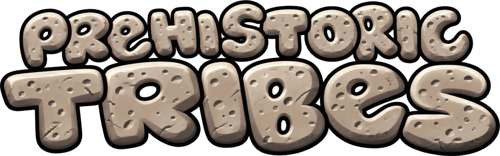

<p align="center">
  
</p>

<h1 align="center">Prehistoric Tribes · Web</h1>

<p align="center">
  <strong>An enhanced web port of the classic 2000s J2ME real-time strategy game <em>Prehistoric Tribes</em>.</strong><br>
  Playable directly in your browser with HD graphics, touch controls, and complete multi-language support.
</p>

<p align="center">
  <a href="README.md">English</a> •
  <a href="README.id.md">Bahasa Indonesia</a>
</p>

<p align="center">
  
  
  <a href="https://github.com/latifangren/prehistoric_tribes_web/actions/workflows/ci.yml"></a>
  <a href="https://latifangren.github.io/prehistoric_tribes_web/"></a>
  <a href="LICENSE"></a>
</p>

---

## 🌟 Acknowledgements & Base Project Credits

> ### 📢 Important Attribution & Asset Ownership
> **1. Original Game & Intellectual Property Rights:**
> * *Prehistoric Tribes* was originally developed by **Gear Games, Ltd.** and published by **THQ Wireless Inc. / THQ Inc.** (© 2008 THQ Wireless Inc. All rights reserved).
> * **All original game assets, visual artwork, character sprites, sound effects, music tracks, scenario narratives, trademarks, and intellectual property remain 100% the property of the original game developers and copyright holders (Gear Games, Ltd. and THQ Inc.).**
>
> **2. Base Web Port & Reverse Engineering:**
> * The web port, reverse engineering of the original J2ME bytecode, state simulation loop, and HD art integration were **100% researched and developed by [BOMBWCC](https://github.com/BOMBWCC)** in the upstream repository:
> * 👉 **Original Upstream Repository:** [https://github.com/BOMBWCC/Prehistoric_Tribes_Web](https://github.com/BOMBWCC/Prehistoric_Tribes_Web)
> * Full credit for creating the faithful browser-based port goes to **BOMBWCC**.
>
> **3. This Community Mod / Fork:**
> * This repository is an enhanced community fork dedicated to introducing Indonesian localization, mobile touch UX ergonomics, haptic feedback, and modern audio performance optimizations.
---

## 🎮 About the Game

*Prehistoric Tribes* (史前部落) was one of the most sophisticated real-time strategy (RTS) games released for mobile phones during the J2ME (Java ME) era in the mid-2000s. Players manage a Stone Age tribe: harvesting berries, hunting mammoths and saber-toothed cats, chopping wood, mining stone, crafting weapons, constructing specialized buildings, raising children, and defending the village against hostile enemy raids.

This web port faithfully reproduces the original game logic frame-for-frame via TypeScript and the HTML5 Canvas API, running natively without requiring any Java emulators.

---

## ✨ Features Added in this Fork

Building upon BOMBWCC's faithful foundation, this enhanced version introduces several modern improvements:

### 🇮🇩 1. Comprehensive Indonesian Localization (Bahasa Indonesia)
* **100% In-Game Translation**: Start Menu, Campaign chapters, Difficulty selection, Settings, Trophies, In-Game HUD, Building menus, Villager information sheets, and Pause Menu.
* **Prehistoric Encyclopedia**: Complete lore and descriptions for all **12 buildings**, **12 villager skills**, and **13 weapons, traps, and shamanic spells** (clubs, spears, throwing axes, pit traps, love potions, healing rituals, etc.).
* **Match Recap Screen**: Detailed post-match analytics featuring population growth timelines, combat statistics, economic metrics, and dynamic rank titles (*Panglima Mitos Prasejarah*, *Kepala Suku Agung*, *Tetua Tangguh*, *Suku yang Tumbang*).
* **Chief Succession**: Fully translated emergency election banner when a tribal chief falls in battle.
* **Asset Integration**: High-definition Indonesian flag icon in the main menu language selector.

### 📱 2. Mobile Ergonomics & Touch Controls
* **Smart 1-Tap Dispatch**: Instant single-tap dispatch with clear feedback indicators.
* **Fat-Finger Hitboxes**: Expanded touch targets for buttons, villager selection, and building tabs.
* **Gesture Lock**: Prevents accidental double-tap and pinch-to-zoom gestures on iOS Safari and Android Chrome.
* **Haptic Feedback**: Integrated Web Vibration API for tactical alerts (enemy raid sirens, building completion, and subtle UI taps).

### ⚡ 3. Unified Audio Performance
* Re-architected SFX, BGM, and ambient audio subsystems to share a single lazy-initialized `AudioContext` singleton.
* Eliminates browser autoplay restriction warnings and reduces audio memory usage on mobile devices.

### 🛠️ 4. Bug Fixes & Refinements
* Fixed hardcoded untranslated Chinese text in the building demolition confirmation modal.
* Refined dialog boxes with localized `[Batal]` and `[Konfirmasi]` actions.
* Resolved responsive HUD layout clipping on narrow mobile screens.

---

## 🕹️ Controls

### Touch / Mouse
The interface is designed for convenient one-handed operation:
* **Drag Screen**: Pan the camera view across the map.
* **Tap Villager**: Select unit. Tap a target (tree, quarry, wild beast, enemy, construction site, or building) to assign a task.
* **Hold & Drag**: Box-select multiple villagers at once.
* **Tap Building**: Open the building action sheet (Demolish, Repair, Upgrade, craft items, or view resident villagers).
* **Build Button (Bottom-Right)**: Browse available structures and blueprint costs; tap to place on the map (✓ Confirm, ✗ Cancel).
* **Command Bar (Above Build)**: Quick orders — Alert / Battle Stations, Gather at Chief's Hut, and Minimap.
* **Squad Formations (Right Edge)**: Tap `+` to bind selected units to a squad number; tap to recall, long-press to disband.
* **Top-Right Menu**: In-game pause menu (Save, Load, Stats, Trophies, Settings, Guide, Quit).

### Keyboard Shortcuts
| Action | Keybinding |
| :--- | :--- |
| Move Cursor / Menu Navigation | `W`, `A`, `S`, `D` or Arrow Keys |
| Confirm / Select | `Enter` or `Space` |
| Left Softkey (Open Build Menu) | `Q` |
| Right Softkey (Back / Cancel / Pause) | `Esc` or `Backspace` |
| Toggle Minimap | `M` |
| Jump to Latest Danger Alert | `1` |
| Quick In-Game Help | `0` |
| Squad Groups | Hold `7` or `9` to save squad; press to select |

*Pro-tip:* Double-tap confirm on an ally to select all visible allied units on screen!

---

## 🚀 Getting Started

### Prerequisites
* [Node.js](https://nodejs.org/) (version 20.0 or higher recommended)
* `npm` (bundled with Node.js)

### Installation & Local Run
```bash
# Clone the repository
git clone https://github.com/latifangren/prehistoric_tribes_web.git
cd prehistoric_tribes_web

# Install dependencies
npm install

# Start local development server (Vite)
npm run dev
```

Once running, navigate to `http://localhost:3000` (or `http://localhost:5173`) in your web browser.

### Building for Production
```bash
npm run build
```
The compiled, production-ready static assets will be output to the `web/dist/` directory, ready to be hosted on GitHub Pages, Cloudflare Pages, Vercel, or any static web host.

---

## 📁 Repository Structure

```text
├── docs/                   # Documentation and translation tables
├── web/
│   ├── public/             # Static game assets
│   │   ├── assets/         # Extracted original J2ME binary sprites, maps, and audio
│   │   └── hd/             # High-definition redrawn sprites, UI, and portrait art
│   ├── scripts/            # Behavioral verification test suites
│   └── src/
│       ├── audio/          # Atmosphere audio & soundscape system
│       ├── combat/         # Combat tactics, formations, and battle formulas
│       ├── core/           # Runtime state, memory arrays, and legacy data structures
│       ├── platform/       # J2ME compatibility layer (Canvas, Audio, Input, Storage, Haptic)
│       ├── render/         # HD art renderer, camera, danger indicators, and match recap
│       ├── sim/            # AI simulation (units, tribe economics, world generation, pathfinding)
│       ├── ui/             # Game states, flow controller, and menu screens
│       ├── Alerts.ts       # Danger notification banner feed and tactical haptics
│       ├── Bestiary.ts     # Prehistoric fauna & enemy stats registry
│       ├── Achievements.ts # Achievement definitions, progress tracking, and persistence
│       ├── AchievementCabinet.ts # Trophy cabinet dialog and filters
│       ├── Hud.ts          # Touch control HUD, action sheets, and building controls
│       ├── Settings.ts     # Multi-tab responsive settings modal
│       ├── StartMenu.ts    # Main menu, campaign browser, and language selector
│       └── main.ts         # Application entry point and loop bootstrap
```

## 🧰 Maintenance Checks

Run the repository checks from the root:

```bash
npm run lint
npm run build
npm test
npm run test:browser --workspace=web
npm run check:size
```

The size gate ratchets the per-file ceilings in `web/scripts/size-baseline.json`. The final target is at most 800 effective lines and fewer than 1,000 physical lines per maintained source file. `LegacyGameState.ts` has a documented physical-line exception for its bytecode field catalog. `LegacyRuntimeState.ts` has an approved facade exception; its current ceiling is fixed to the measured size and must not grow.


---

## 📜 Disclaimer & Asset Licensing

* **Asset Ownership Notice:** All original in-game assets—including but not limited to textures, sprites, animations, sound effects, MIDI tracks, dialogues, and game design concepts—are the exclusive intellectual property of the original game developer, **Gear Games, Ltd.**, and publisher, **THQ Wireless Inc. / THQ Inc.** (© 2008 THQ Wireless Inc.). Neither BOMBWCC nor the maintainers of this repository claim any ownership over these original assets.
* **Split MIT License:** The source code and custom tooling created for this web port are licensed under the [MIT License](LICENSE). Original game assets are explicitly excluded from this license.
* **Non-Commercial Fan Preservation:** This project is an unofficial, non-profit, educational open-source fan recreation developed strictly for historical preservation, research, and learning purposes. No commercial monetization or proprietary licensing applies to the original game contents.
* **Web Port Credit:** All credit for the web port reverse-engineering and implementation goes to **[BOMBWCC](https://github.com/BOMBWCC/Prehistoric_Tribes_Web)**.
